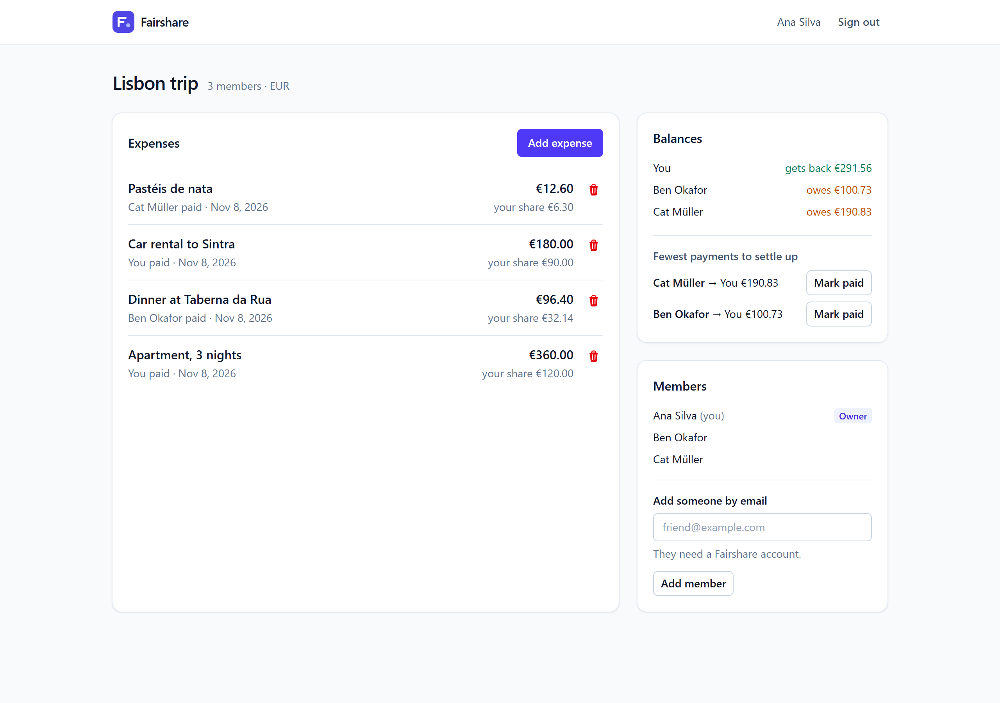
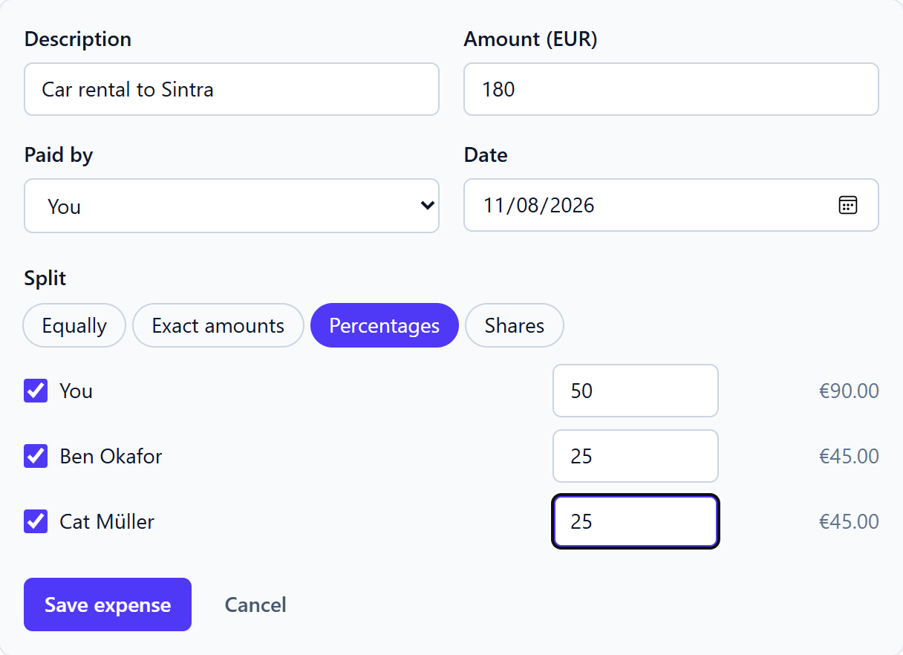
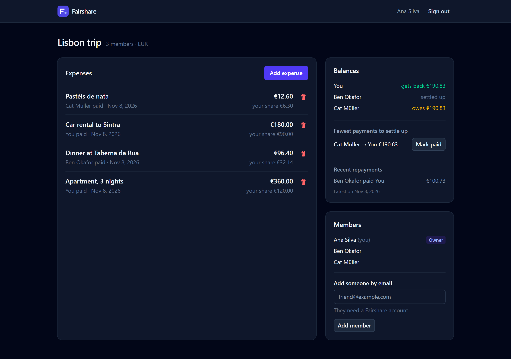
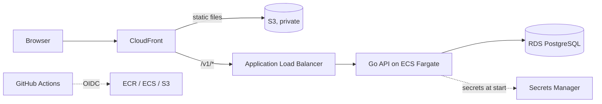

# Fairshare

[](https://github.com/dehghanpur10/fairshare/actions/workflows/api.yml)
[](https://github.com/dehghanpur10/fairshare/actions/workflows/web.yml)
[](https://github.com/dehghanpur10/fairshare/actions/workflows/infra.yml)

Split shared costs in a group (a trip, a flat, a dinner club) and settle up
with the fewest possible payments.

A Go API, a React client and the AWS infrastructure to run them, in one
repository.



## Features

- Groups with an owner and members, each group in its own currency
- Four ways to split an expense: equally, by exact amounts, by percentage,
  or by shares (2 for a couple, 1 for a single)
- Live per-person preview while you enter an expense, computed with the
  same algorithm the server uses
- Balances for every member and a short list of payments that settles the
  whole group, which a payer or payee can mark as paid
- Dark mode and phone layouts

<p>
  
  
</p>

## Architecture



One CloudFront distribution serves the app and proxies the API, so the
browser only ever talks to one origin: no CORS in production, and the load
balancer accepts traffic only from CloudFront. Tasks run in private
subnets and the database sits in isolated subnets with no internet route.

| Part | Built with |
| --- | --- |
| [`api/`](api) | Go 1.27, standard library router, pgx, goose migrations, JWT, slog |
| [`web/`](web) | React 19, TypeScript 7, Vite, TanStack Query, React Hook Form, Zod, Tailwind CSS 4 |
| [`infra/`](infra) | Terraform: VPC, ECS Fargate (ARM64), RDS, ALB, CloudFront, S3, ECR, IAM |
| CI/CD | GitHub Actions with OIDC deploys, Dependabot |

## Design notes

**Money is never a float.** Amounts are integer minor units end to end:
`bigint` in Postgres, `int64` in Go, and parsed straight from the text
field into cents in the browser. Splits use the largest remainder method,
so 100.00 between three people is 33.34 + 33.33 + 33.33 and every cent is
accounted for. Property tests in
[`ledger`](api/internal/ledger) check this across thousands of random
cases.

**Settling up.** Members are split into debtors and creditors, sorted by
size and paired largest first. Each payment clears at least one person,
so a group of *n* never needs more than *n − 1* payments. The true minimum
is NP-hard, so this is the usual practical compromise.

**The database enforces membership.** Expenses, shares and settlements
reference `group_members` through composite foreign keys, so Postgres
itself rejects a payer or participant who is not in the group. The
service layer checks first to give a friendly message; the schema is the
guarantee.

**Contract first.** [`api/openapi.yaml`](api/openapi.yaml) describes the
API, the web client's types are generated from it, and CI fails if the
generated file is out of date. Errors follow RFC 9457 problem details, and
validation errors carry a message per field, which the forms map back onto
the matching inputs.

**Access rules.** A group you are not in returns 404, not 403, so group IDs
cannot be probed. Only the owner adds members, an expense can be deleted
by whoever added it or by the owner, and a repayment can be recorded by
either person involved. Login runs a bcrypt comparison even for unknown
emails so response times do not reveal which accounts exist.

**Pagination** is keyset-based on `(created_at, id)` with opaque cursors,
so pages stay stable while new expenses are added and the query uses an
index instead of `OFFSET`.

## Running locally

Everything in containers (needs Docker):

```sh
docker compose up --build
```

Then open http://localhost:3000. Postgres is published on port 5433 so it
does not clash with one already running on your machine.

For development with hot reload, run the database in Docker and the rest
natively (Go 1.27+ and Node 22+):

```sh
docker compose up -d db

cd api
cp .env.example .env
make migrate
make run            # http://localhost:8080

cd web              # in another terminal
npm ci
npm run dev         # http://localhost:5173, proxies /v1 to the API
```

## Tests

```sh
cd api
make test       # unit tests
make test-db    # also store and HTTP tests against TEST_DATABASE_URL
make lint

cd web
npm test
npm run typecheck && npm run lint
```

Database tests create a fresh schema per test and drop it afterwards, so
they run in parallel and can point at the development database. The HTTP
tests drive the real router, service and store against Postgres.

## Deploying to AWS

1. Create an S3 bucket for Terraform state, then copy
   `infra/backend.hcl.example` to `infra/backend.hcl` and fill it in.
2. Apply the infrastructure:
   ```sh
   cd infra
   terraform init -backend-config=backend.hcl
   terraform apply
   ```
3. In the GitHub repository, add each value from
   `terraform output github_actions_variables` as an Actions variable and
   create an environment named `production`.
4. Run the **Deploy** workflow, or push to `main`. It builds and pushes the
   image, runs migrations as a one-off task, rolls out the API, then
   publishes the web app. `terraform output app_url` prints the address.

The API service has no image until the first deploy, so it stays unhealthy
between `terraform apply` and step 4. The main costs are the NAT gateway,
the load balancer, the RDS instance and Fargate tasks.

## Trade-offs and next steps

- **CloudFront to ALB is plain HTTP**, guarded by CloudFront's prefix list
  and a secret header. With a custom domain, the ALB should get an ACM
  certificate and the origin should switch to HTTPS only.
- **RDS rotates the database password**, but ECS injects secrets only when
  a task starts. A task that outlives a rotation cannot open new
  connections until it restarts. IAM database authentication or reading
  the secret in a pgx `BeforeConnect` hook would remove that gap.
- **Access tokens live in `localStorage`.** A short-lived token plus a
  refresh token in an `httpOnly` cookie would limit what an XSS bug could
  steal.
- **No rate limiting on login yet.** A WAF rate-based rule on the
  distribution is the cheapest fix.
- Members cannot leave or be removed from a group yet.

## Project layout

```
api/
  cmd/fairshare/      entry point: serve and migrate commands
  internal/ledger/    splitting and settling, no I/O
  internal/service/   validation and access rules
  internal/store/     Postgres queries
  internal/httpapi/   routes, middleware, JSON and error handling
  migrations/         SQL migrations, embedded in the binary
  openapi.yaml
web/
  src/api/            generated types, client, React Query hooks
  src/features/       screens: auth, groups, expenses, balances
  src/lib/            money, split and date helpers
infra/                Terraform for AWS
.github/workflows/    CI and deploy
```

## License

[MIT](LICENSE)
